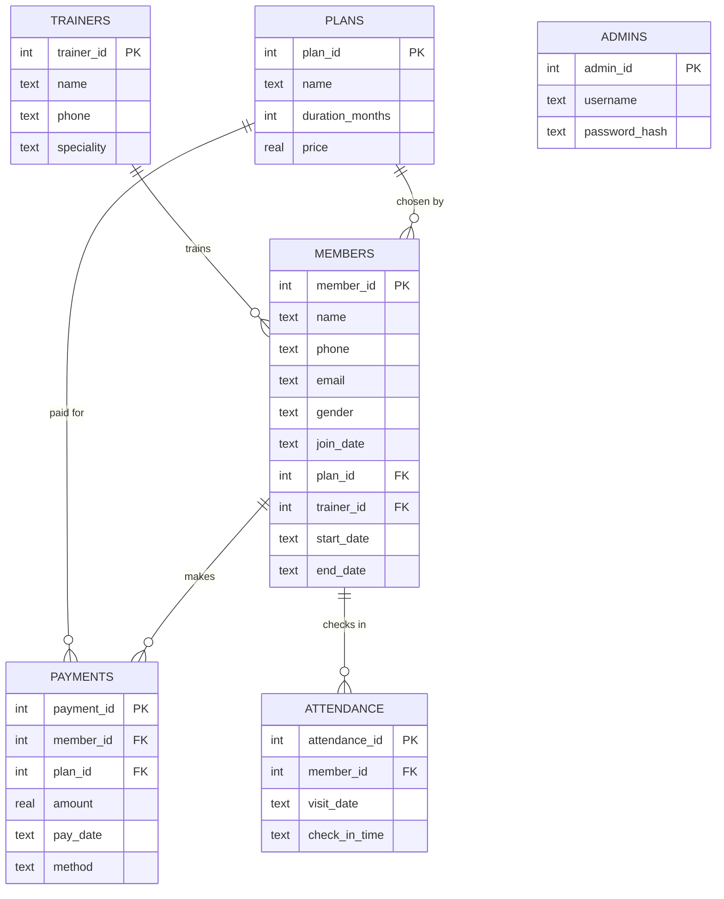
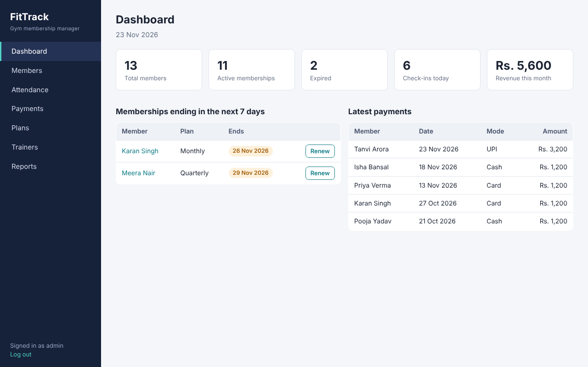
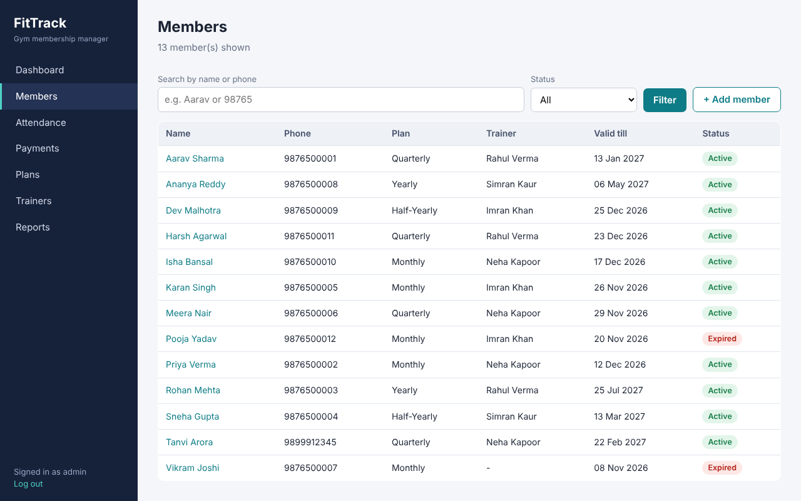
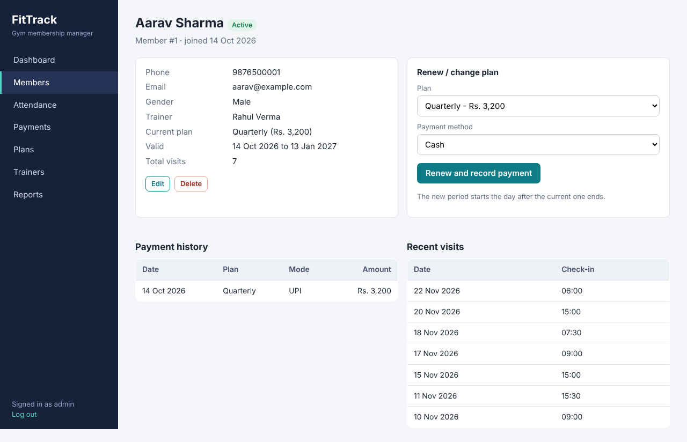
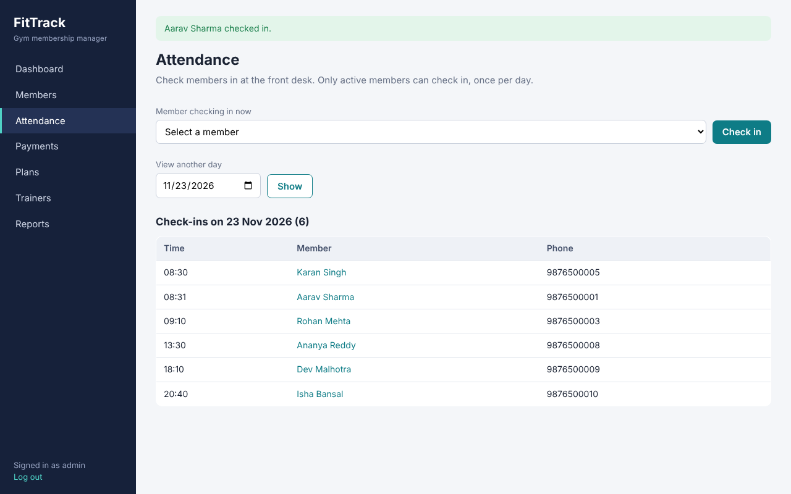
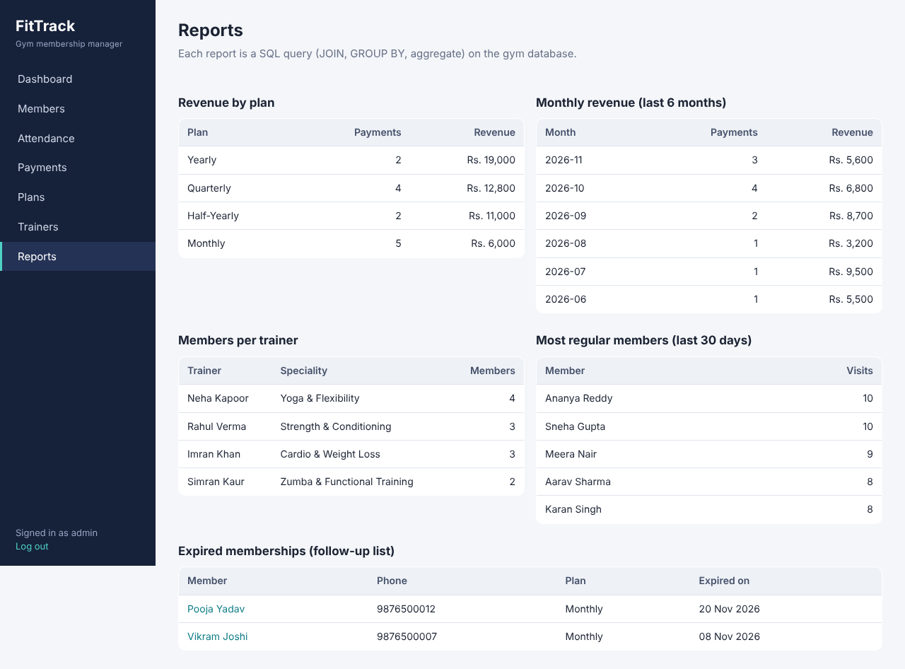
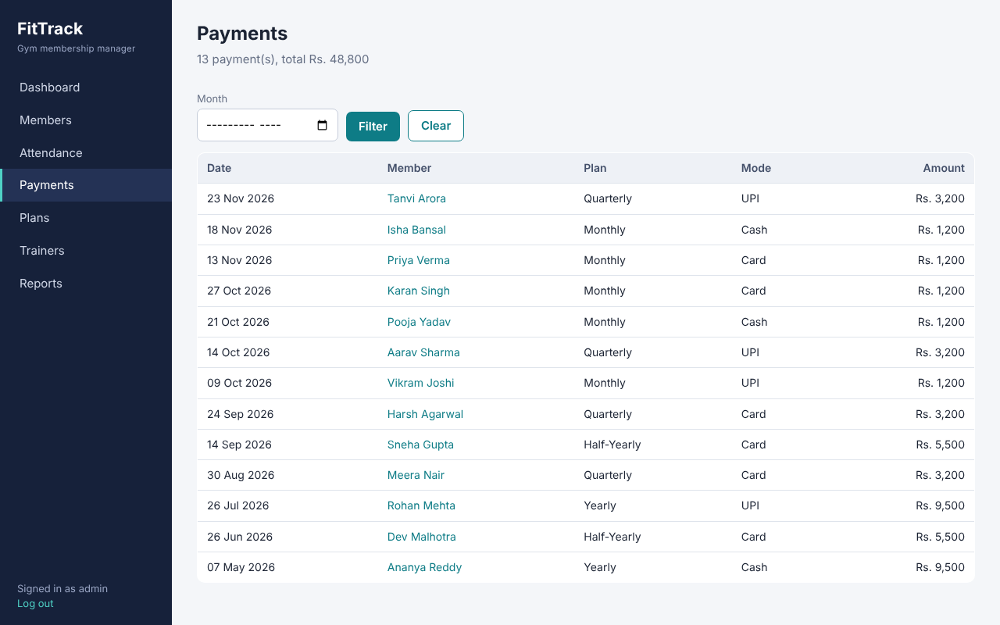

# FitTrack - Gym Membership & Attendance Manager

A working web application with a proper relational database that a gym front desk can use to
register members, sell and renew membership plans, take payments, mark daily attendance and see reports.

Built with **Python (Flask)** and **SQLite**. No extra database server is needed, so it runs on any laptop.

## Problem it solves
Small gyms still track members in notebooks or Excel sheets. Expired memberships get missed, payments are
hard to total, and nobody knows which members actually attend. FitTrack keeps all of this in one database
and shows it on a simple dashboard.

## Features
- Admin login (password stored as a hash, not plain text)
- Dashboard: total / active / expired members, check-ins today, revenue this month, memberships ending in 7 days
- Members: add, search, filter by status, edit, delete
- Renewal: renewing records a payment and extends the membership correctly (starts after the old end date if still active, otherwise from today)
- Plans: add plans, change price, delete (blocked if the plan is in use)
- Trainers: add / remove trainers and assign them to members
- Attendance: front-desk check-in (only active members, one check-in per member per day)
- Payments: full history with month filter and total
- Reports: revenue by plan, monthly revenue, members per trainer, most regular members, expired follow-up list
- Input validation (10 digit phone, valid email, duplicate phone blocked) and 12 automated tests

## Database design
Six tables in Third Normal Form, foreign keys switched on, with CHECK / UNIQUE constraints, indexes and one view.



| Table | Purpose | Key rules |
|---|---|---|
| plans | membership plans | name unique, duration > 0, price >= 0 |
| trainers | gym trainers | phone unique |
| members | gym members | phone unique, plan required, trainer optional (set to NULL if trainer removed) |
| payments | every payment made | amount > 0, method in (Cash, UPI, Card), deleted with the member |
| attendance | daily check-ins | UNIQUE(member_id, visit_date) so a member cannot check in twice a day |
| admins | login users | hashed password |

View `v_member_details` joins members with their plan and trainer names. The full SQL is in `schema.sql`.

Sample queries used by the reports page:
```sql
-- revenue by plan
SELECT pl.name, COUNT(p.payment_id) AS payments, COALESCE(SUM(p.amount),0) AS revenue
FROM plans pl LEFT JOIN payments p ON p.plan_id = pl.plan_id
GROUP BY pl.plan_id ORDER BY revenue DESC;

-- members per trainer
SELECT t.name, COUNT(m.member_id) AS members
FROM trainers t LEFT JOIN members m ON m.trainer_id = t.trainer_id
GROUP BY t.trainer_id;
```

## How to run
1. Install Python 3.10 or newer.
2. Open a terminal in this project folder and run:
```
pip install -r requirements.txt
python app.py
```
3. Open http://127.0.0.1:5000 in the browser.
4. Login with **admin / admin123**.

The first run creates `gym.db` automatically with 4 plans, 4 trainers, 12 members, their payments and recent attendance,
so the app is ready to demo. To start fresh, delete `gym.db` and run again.

## Run the tests
```
python -m unittest discover -s tests -v
```

## Project structure
```
app.py          Flask routes (dashboard, members, plans, trainers, attendance, payments, reports)
db.py           database connection, transactions, sample data
schema.sql      tables, constraints, indexes, view
templates/      HTML pages (Jinja)
static/         CSS
tests/          automated tests
docs/           screenshots
```

## Screenshots
| | |
|---|---|
|  |  |
|  |  |
|  |  |

## Future scope
SMS/WhatsApp reminders before a membership expires, member self-service login, multiple branches, export of reports to PDF/Excel.
